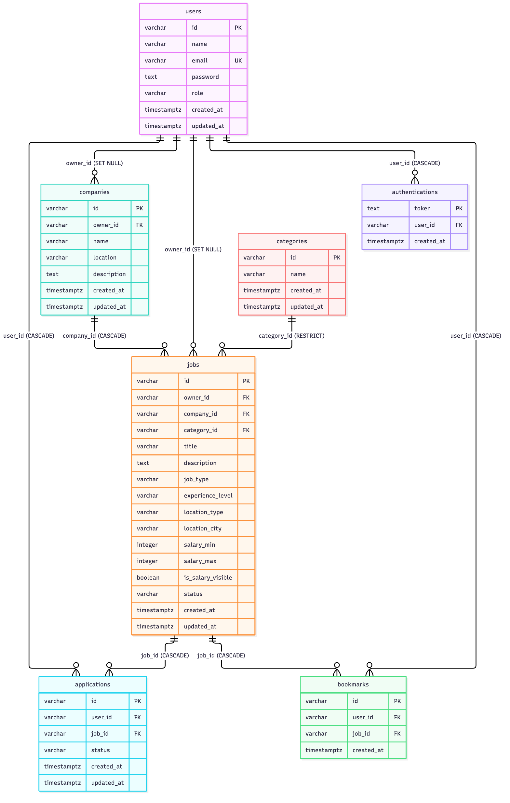

# 💼 OpenJob RESTful API (Versi 1)

[](https://nodejs.org/)
[](https://expressjs.com/)
[](https://www.postgresql.org/)
[](https://jwt.io/)

> **Submission Pertama:** _OpenJob RESTful API Versi 1_  
> Program **Belajar Fundamental Back-End dengan JavaScript** — **Dicoding Indonesia**  
> Kolaborasi Program **Asah led by Dicoding Supported by GoTo** & **PLK Akomodasi Klaim Universitas Negeri Yogyakarta (UNY) Studi Mandiri**.

---

## 📑 Daftar Isi

- [Tentang Proyek](#-tentang-proyek)
- [Kriteria Submission & Fitur Lengkap](#-kriteria-submission--fitur-lengkap)
  - [Kriteria 1: Database](#kriteria-1-menggunakan-database-untuk-menyimpan-data)
  - [Kriteria 2: Autentikasi dan Otorisasi](#kriteria-2-autentikasi-dan-otorisasi)
  - [Fitur Tambahan & Keamanan](#fitur-tambahan--keamanan)
- [Daftar Endpoint REST API](#-daftar-endpoint-rest-api)
- [Format Response](#-format-response)
- [Struktur Direktori](#-struktur-direktori)
- [Skema Database & ERD](#-skema-database--erd)
- [Teknologi yang Digunakan](#-teknologi-yang-digunakan)
- [Panduan Instalasi & Menjalankan Proyek](#-panduan-instalasi--menjalankan-proyek)
  - [Prasyarat](#prasyarat)
  - [Langkah Instalasi](#langkah-instalasi)
  - [Konfigurasi Environment](#konfigurasi-environment)
  - [Menjalankan Migration](#menjalankan-migration)
  - [Menjalankan Server](#menjalankan-server)
  - [Skrip NPM](#skrip-npm)
- [Pengujian dengan Postman](#-pengujian-dengan-postman)
- [Dokumentasi Arsitektur](#-dokumentasi-arsitektur)
- [Developer](#-developer)

---

## 📖 Tentang Proyek

**OpenJob RESTful API (Versi 1)** adalah layanan back-end untuk aplikasi perekrutan karyawan internal perusahaan. API ini mengelola data **pengguna, perusahaan, kategori pekerjaan, lowongan, lamaran, dan bookmark**, lengkap dengan autentikasi berbasis token.

Seluruh arsitektur dibangun dengan standar industri:

- **JavaScript & Express** murni dengan **ES Modules** (standar modern, native di Node.js 22, dan didukung `node-pg-migrate`).
- **Arsitektur berlapis**: route → controller → service, dengan query SQL hanya di lapisan service.
- Database **PostgreSQL** dengan skema yang dikelola penuh oleh **migration** (`node-pg-migrate`).
- Seluruh query memakai **parameterized query** (anti SQL injection) dan **transaksi** untuk operasi multi-langkah.
- Validasi data dengan **Joi** melalui middleware yang dapat dipakai ulang.
- Autentikasi **JWT (Bearer token)** tanpa session maupun cookie.

---

## 🏆 Kriteria Submission & Fitur Lengkap

### Kriteria 1: Menggunakan Database untuk Menyimpan Data

- **Basic**
  - Seluruh data tersimpan di **PostgreSQL**.
  - Struktur tabel dikelola `node-pg-migrate`, nama file berawalan timestamp otomatis (contoh `1793471444624_create-table-users.js`), dan setiap migration memiliki `up` serta `down`.
  - Kredensial tidak ditulis di kode. Seluruhnya dari `.env`: `PGUSER`, `PGPASSWORD`, `PGDATABASE`, `PGHOST`, `PGPORT`, serta `HOST` dan `PORT`.
  - Server berjalan dengan `npm run start:dev`.
  - Validasi data memakai **Joi**.
- **Skilled**
  - Middleware validasi Joi yang reusable: `validate(schema, source)`.
  - Middleware **error handling** terpusat dan middleware **404 Not Found**, dengan custom error class `ClientError`, `InvariantError`, `NotFoundError`, `AuthenticationError`, dan `AuthorizationError`. Error server (500) tidak membocorkan detail ke client dan dicatat di log.
  - **Unique constraint** pada `users.email`. Pelanggaran (kode PostgreSQL `23505`) diubah menjadi response `400` yang rapi.
- **Advanced**
  - Database **ternormalisasi (3NF)** dengan relasi foreign key dan aturan `ON DELETE` yang tepat, serta index pada kolom yang sering dicari atau di-join.
  - **ERD** tersedia di [`docs/ERD-OpenJob-versi-1.png`](docs/ERD-OpenJob-versi-1.png).
  - `GET /jobs` mendukung pencarian `?title=` dan `?company-name=` (dapat digabung) dengan `ILIKE`, `JOIN` ke tabel `companies`, dan parameterized query.
  - Seluruh pengujian Postman (wajib dan opsional) lulus.

### Kriteria 2: Autentikasi dan Otorisasi

- **Basic**
  - Semua endpoint terimplementasi dengan pemisahan **publik** dan **terproteksi** sesuai ketentuan. Seluruh `GET` publik, kecuali `/applications`, `/bookmarks`, dan `/profile`.
  - Token dikirim melalui header `Authorization: Bearer <access_token>`.
  - Payload JWT berisi **`id`** user.
  - **Refresh token** ditandatangani dengan benar dan tersimpan di tabel `authentications`. Login menyimpan token, refresh memverifikasi signature dan keberadaannya di database, logout menghapusnya.
  - Password di-hash dengan **bcrypt** dan tidak pernah dikembalikan di response.
- **Skilled**
  - **Middleware auth** memverifikasi access token dan menempelkan data user ke `req.user`.
  - Rute terproteksi `GET /profile`, `GET /profile/applications`, dan `GET /profile/bookmarks`.
  - Otorisasi berbasis kepemilikan data (lihat [Dokumentasi Arsitektur](#-dokumentasi-arsitektur)).
- **Advanced**
  - Secret key dari environment variable **`ACCESS_TOKEN_KEY`** dan **`REFRESH_TOKEN_KEY`**.
  - Access token berlaku **3 jam** (`ACCESS_TOKEN_AGE`, default `3h`).
  - Seluruh pengujian Postman (wajib dan opsional) lulus.

### Fitur Tambahan & Keamanan

- **`helmet`** dan **`cors`** sebagai lapisan keamanan HTTP dasar.
- **Transaksi database** (`BEGIN`/`COMMIT`/`ROLLBACK`) pada pembuatan lamaran dan bookmark, dengan `FOR SHARE` agar job tidak terhapus di tengah proses.
- **Pencarian aman:** karakter wildcard `%` dan `_` pada input pencarian di-escape agar dicari secara literal.
- **ESLint & Prettier** untuk gaya kode yang konsisten.
- Penanganan error JSON rusak, pelanggaran foreign key, dan duplikasi data menjadi response `400` yang informatif.

---

## 🌐 Daftar Endpoint REST API

Base URL lokal: `http://localhost:3000`

### Endpoint Publik

| Method | Endpoint                     | Deskripsi                                                                |
| :----- | :--------------------------- | :----------------------------------------------------------------------- |
| `POST` | `/users`                     | Registrasi user baru                                                     |
| `GET`  | `/users/:id`                 | Detail user                                                              |
| `POST` | `/authentications`           | Login, memperoleh `accessToken` dan `refreshToken`                       |
| `PUT`  | `/authentications`           | Memperbarui access token dengan refresh token                            |
| `GET`  | `/companies`                 | Daftar company                                                           |
| `GET`  | `/companies/:id`             | Detail company                                                           |
| `GET`  | `/categories`                | Daftar category                                                          |
| `GET`  | `/categories/:id`            | Detail category                                                          |
| `GET`  | `/jobs`                      | Daftar job, mendukung `?title=` dan `?company-name=` (dapat digabungkan) |
| `GET`  | `/jobs/:id`                  | Detail job                                                               |
| `GET`  | `/jobs/company/:companyId`   | Job berdasarkan company                                                  |
| `GET`  | `/jobs/category/:categoryId` | Job berdasarkan category                                                 |

### Endpoint Terproteksi (`Authorization: Bearer <access_token>`)

| Method   | Endpoint                     | Deskripsi                                 |
| :------- | :--------------------------- | :---------------------------------------- |
| `DELETE` | `/authentications`           | Logout (menghapus refresh token)          |
| `GET`    | `/profile`                   | Profil user yang sedang login             |
| `GET`    | `/profile/applications`      | Lamaran milik user yang login             |
| `GET`    | `/profile/bookmarks`         | Bookmark milik user yang login            |
| `POST`   | `/companies`                 | Membuat company                           |
| `PUT`    | `/companies/:id`             | Mengubah company (pemilik)                |
| `DELETE` | `/companies/:id`             | Menghapus company (pemilik)               |
| `POST`   | `/categories`                | Membuat category                          |
| `PUT`    | `/categories/:id`            | Mengubah category                         |
| `DELETE` | `/categories/:id`            | Menghapus category                        |
| `POST`   | `/jobs`                      | Membuat job (pada company milik sendiri)  |
| `PUT`    | `/jobs/:id`                  | Mengubah job (pemilik)                    |
| `DELETE` | `/jobs/:id`                  | Menghapus job (pemilik)                   |
| `POST`   | `/applications`              | Melamar pekerjaan                         |
| `GET`    | `/applications`              | Daftar lamaran yang dapat diakses         |
| `GET`    | `/applications/:id`          | Detail lamaran                            |
| `GET`    | `/applications/user/:userId` | Lamaran berdasarkan user                  |
| `GET`    | `/applications/job/:jobId`   | Lamaran berdasarkan job                   |
| `PUT`    | `/applications/:id`          | Mengubah status lamaran (pemilik job)     |
| `DELETE` | `/applications/:id`          | Menghapus lamaran                         |
| `POST`   | `/jobs/:jobId/bookmark`      | Menyimpan bookmark job                    |
| `GET`    | `/jobs/:jobId/bookmark/:id`  | Detail bookmark                           |
| `DELETE` | `/jobs/:jobId/bookmark`      | Menghapus bookmark berdasarkan user & job |
| `GET`    | `/bookmarks`                 | Semua bookmark user yang login            |

---

## 📦 Format Response

```json
{ "status": "success", "message": "opsional", "data": {} }
{ "status": "failed", "message": "alasan kegagalan" }
```

| Status Code | Arti                                                                   |
| :---------- | :--------------------------------------------------------------------- |
| `200`       | Permintaan berhasil                                                    |
| `201`       | Data berhasil dibuat                                                   |
| `400`       | Payload tidak valid, refresh token tidak valid, atau data duplikat     |
| `401`       | Token tidak ada, tidak valid, kedaluwarsa, atau kredensial login salah |
| `403`       | Terautentikasi tetapi bukan pemilik data                               |
| `404`       | Data atau route tidak ditemukan                                        |
| `500`       | Kesalahan server (detail hanya di log server)                          |

---

## 📂 Struktur Direktori

```text
Submission- OpenJob RESTful API Versi 1/
├── docs/
│   ├── ERD-OpenJob-versi-1.png       # ERD (gambar)
│   └── ERD-OpenJob-versi-1.mmd       # Sumber diagram (Mermaid)
├── migrations/                       # Migration node-pg-migrate (timestamp otomatis)
│   ├── 1793471444624_create-table-users.js
│   ├── 1793471445126_create-table-companies.js
│   ├── 1793471445613_create-table-categories.js
│   ├── 1793471446129_create-table-jobs.js
│   ├── 1793471446644_create-table-applications.js
│   ├── 1793471447144_create-table-bookmarks.js
│   └── 1793471447644_create-table-authentications.js
├── src/
│   ├── config/
│   │   ├── database.js               # pg.Pool bersama & helper transaksi
│   │   └── env.js                    # Pembacaan environment & konfigurasi token
│   ├── controllers/                  # Handler HTTP tipis (tanpa SQL)
│   │   ├── applicationsController.js
│   │   ├── authenticationsController.js
│   │   ├── bookmarksController.js
│   │   ├── categoriesController.js
│   │   ├── companiesController.js
│   │   ├── jobsController.js
│   │   ├── profileController.js
│   │   └── usersController.js
│   ├── exceptions/                   # Custom error class
│   │   ├── AuthenticationError.js    # 401
│   │   ├── AuthorizationError.js     # 403
│   │   ├── ClientError.js            # Basis error client
│   │   ├── InvariantError.js         # 400
│   │   └── NotFoundError.js          # 404
│   ├── middlewares/
│   │   ├── auth.js                   # Verifikasi access token (Bearer)
│   │   ├── errorHandler.js           # Error handling terpusat
│   │   ├── notFound.js               # Handler route tidak ditemukan
│   │   └── validate.js               # Middleware validasi Joi (reusable)
│   ├── routes/                       # Definisi route per resource
│   │   ├── index.js
│   │   ├── applications.js
│   │   ├── authentications.js
│   │   ├── bookmarks.js
│   │   ├── categories.js
│   │   ├── companies.js
│   │   ├── jobs.js
│   │   ├── profile.js
│   │   └── users.js
│   ├── services/                     # Logika bisnis & query ke database
│   │   ├── applicationsService.js
│   │   ├── authenticationsService.js
│   │   ├── bookmarksService.js
│   │   ├── categoriesService.js
│   │   ├── companiesService.js
│   │   ├── jobsService.js
│   │   └── usersService.js
│   ├── utils/
│   │   ├── asyncHandler.js           # Pembungkus handler async
│   │   ├── id.js                     # Generator ID (nanoid)
│   │   ├── response.js               # Helper format response
│   │   └── tokenManager.js           # Pembuatan & verifikasi JWT
│   ├── validators/                   # Skema Joi per resource
│   ├── app.js                        # Inisialisasi Express (tanpa listen)
│   └── server.js                     # Entry point (listen HOST:PORT)
├── OpenJob RESTful API V1 Test/      # Koleksi & environment Postman dari Dicoding
├── .env.example                      # Template environment (tanpa nilai rahasia)
├── .gitignore
├── .prettierrc
├── eslint.config.js
├── package.json
└── README.md
```

---

## 🗄️ Skema Database & ERD



| Tabel             | Keterangan                                                 | Relasi & aturan `ON DELETE`                                                                                          |
| :---------------- | :--------------------------------------------------------- | :------------------------------------------------------------------------------------------------------------------- |
| `users`           | Data pengguna. `email` bersifat **unik**.                  | —                                                                                                                    |
| `companies`       | Profil perusahaan.                                         | `owner_id` → `users` (`SET NULL`)                                                                                    |
| `categories`      | Kategori pekerjaan.                                        | —                                                                                                                    |
| `jobs`            | Lowongan pekerjaan.                                        | `company_id` → `companies` (`CASCADE`), `category_id` → `categories` (`RESTRICT`), `owner_id` → `users` (`SET NULL`) |
| `applications`    | Lamaran. Pasangan `user_id` + `job_id` bersifat **unik**.  | `user_id` → `users` (`CASCADE`), `job_id` → `jobs` (`CASCADE`)                                                       |
| `bookmarks`       | Job yang disimpan. Pasangan `user_id` + `job_id` **unik**. | `user_id` → `users` (`CASCADE`), `job_id` → `jobs` (`CASCADE`)                                                       |
| `authentications` | Refresh token yang masih aktif.                            | `user_id` → `users` (`CASCADE`)                                                                                      |

---

## 💻 Teknologi yang Digunakan

- **Runtime:** [Node.js](https://nodejs.org/) (v22 atau lebih baru)
- **Framework:** [Express](https://expressjs.com/)
- **Database:** [PostgreSQL](https://www.postgresql.org/) dengan driver [`pg`](https://node-postgres.com/)
- **Migration:** [`node-pg-migrate`](https://salsita.github.io/node-pg-migrate/)
- **Validasi:** [Joi](https://joi.dev/)
- **Autentikasi:** [`jsonwebtoken`](https://github.com/auth0/node-jsonwebtoken) dan [`bcrypt`](https://github.com/kelektiv/node.bcrypt.js)
- **Keamanan:** [`helmet`](https://helmetjs.github.io/) dan [`cors`](https://github.com/expressjs/cors)
- **Utilitas:** [`dotenv`](https://github.com/motdotla/dotenv), [`nanoid`](https://github.com/ai/nanoid)
- **Tooling:** [`nodemon`](https://nodemon.io/), [ESLint](https://eslint.org/), dan [Prettier](https://prettier.io/)

---

## 🛠️ Panduan Instalasi & Menjalankan Proyek

### Prasyarat

Pastikan komputer Anda telah terinstal:

- [Node.js](https://nodejs.org/) versi **22 atau lebih baru**
- npm (Node Package Manager)
- [PostgreSQL](https://www.postgresql.org/download/) beserta database kosong dan user yang berhak mengaksesnya

### Langkah Instalasi

1. **Clone repositori ini:**

   ```bash
   git clone https://github.com/alfinhimawan/Submission-OpenJob-RESTful-API-Versi-1.git
   ```

2. **Masuk ke direktori proyek:**

   ```bash
   cd Submission-OpenJob-RESTful-API-Versi-1
   ```

3. **Install seluruh dependensi:**

   ```bash
   npm install
   ```

### Konfigurasi Environment

Salin template lalu isi nilainya:

```bash
cp .env.example .env
```

| Variabel                         | Keterangan                                           |
| :------------------------------- | :--------------------------------------------------- |
| `HOST`, `PORT`                   | Alamat server HTTP (contoh `localhost`, `3000`)      |
| `PGUSER`, `PGPASSWORD`           | Kredensial PostgreSQL                                |
| `PGDATABASE`, `PGHOST`, `PGPORT` | Nama database dan lokasi server PostgreSQL           |
| `ACCESS_TOKEN_KEY`               | Secret access token (string acak yang panjang)       |
| `REFRESH_TOKEN_KEY`              | Secret refresh token (harus berbeda dari access key) |
| `ACCESS_TOKEN_AGE` _(opsional)_  | Masa berlaku access token, default `3h`              |
| `REFRESH_TOKEN_AGE` _(opsional)_ | Masa berlaku refresh token, default `7d`             |

Membuat secret acak:

```bash
node -e "console.log(require('crypto').randomBytes(64).toString('hex'))"
```

> [!WARNING]
> File `.env` berisi data rahasia. Jangan di-commit, jangan dibagikan, dan pastikan tercantum di `.gitignore`.

### Menjalankan Migration

```bash
npm run migrate:up
```

Perintah lain terkait migration:

```bash
npm run migrate:down -- 7                # membatalkan 7 migration (mengosongkan semua tabel)
npx node-pg-migrate create <nama>        # membuat file migration baru (timestamp otomatis)
```

### Menjalankan Server

Mode pengembangan (auto-reload dengan `nodemon`):

```bash
npm run start:dev
```

Mode produksi:

```bash
npm start
```

Server berjalan di `http://localhost:3000` (sesuai `HOST` dan `PORT`).

### Skrip NPM

| Skrip                  | Fungsi                              |
| :--------------------- | :---------------------------------- |
| `npm run start:dev`    | Menjalankan server dengan `nodemon` |
| `npm start`            | Menjalankan server (produksi)       |
| `npm run migrate:up`   | Menjalankan migration               |
| `npm run migrate:down` | Membatalkan migration               |
| `npm run lint`         | Memeriksa kode dengan ESLint        |
| `npm run format`       | Merapikan kode dengan Prettier      |

---

## 🧪 Pengujian dengan Postman

1. Jalankan server (`npm run start:dev`).
2. Di Postman, **Import** dua berkas dari folder `OpenJob RESTful API V1 Test/`: koleksi `[271] OpenJob API Test V1` dan environment `OpenJob API`.
3. Pilih environment **OpenJob API**, lalu jalankan koleksi lewat **Run collection** tanpa mengubah urutan.

Hasil terakhir: **296 dari 296 test lulus** (folder Mandatory dan Opsional).

> [!IMPORTANT]
> Karena `users.email` bersifat unik, koleksi hanya dapat dijalankan sekali pada database yang sama. Sebelum menjalankan ulang, reset database:
>
> ```bash
> npm run migrate:down -- 7 && npm run migrate:up
> ```

---

## 🏛️ Dokumentasi Arsitektur

### Alur Autentikasi

1. **Login** (`POST /authentications`): kredensial diverifikasi (bcrypt), lalu dibuat `accessToken` (3 jam) dan `refreshToken`. Refresh token disimpan di tabel `authentications`.
2. **Mengakses endpoint terproteksi:** middleware `auth` memverifikasi `accessToken` dan mengisi `req.user = { id }`. Token tidak ada atau tidak valid menghasilkan `401`.
3. **Refresh** (`PUT /authentications`): signature refresh token diverifikasi dengan `REFRESH_TOKEN_KEY`, lalu keberadaannya di database dipastikan. Bila valid, access token baru diterbitkan. Access token tidak dapat dipakai sebagai refresh token karena kunci keduanya berbeda.
4. **Logout** (`DELETE /authentications`): refresh token dihapus dari database sehingga tidak dapat dipakai lagi.

### Alur Request

```text
Request → helmet/cors/json → Route → [auth] → [validate (Joi)] → Controller → Service → PostgreSQL
                                                                         ↓
                               Response ← errorHandler (error apa pun dari lapisan di atas)
```

### Otorisasi (Kepemilikan Data)

- **Company dan job** hanya dapat diubah atau dihapus oleh pembuatnya (`403` jika bukan).
- **Job** hanya dapat dibuat pada company milik sendiri.
- **Lamaran** hanya terlihat oleh pelamar dan pemilik job. Status lamaran hanya dapat diubah oleh pemilik job. Pelamar hanya dapat melamar atas nama sendiri dengan status awal `pending`.
- **Bookmark** hanya dapat diakses oleh pemiliknya.
- **Category** dapat dikelola oleh setiap user yang login.

### Penanganan Error

Seluruh error ditangani di `middlewares/errorHandler.js`:

- Turunan `ClientError` dikirim dengan status code masing-masing.
- Error PostgreSQL `23505` (unique) dan `23503` (foreign key) diubah menjadi `400` dengan pesan yang jelas.
- Error tak terduga menjadi `500` dengan pesan generik. Detailnya hanya dicatat di log server.

---

## 👨‍💻 Developer

- **Nama:** Alfin Himawan Santosa
- **Program:** Asah led by Dicoding Supported by GoTo — PLK Akomodasi Klaim Universitas Negeri Yogyakarta (UNY) Studi Mandiri
- **Dicoding Profile:** [alfinhimawan](https://www.dicoding.com/users/alfinhimawan/academies)
- **GitHub:** [@alfinhimawan](https://github.com/alfinhimawan)
